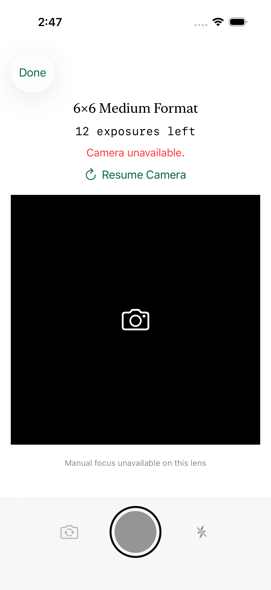
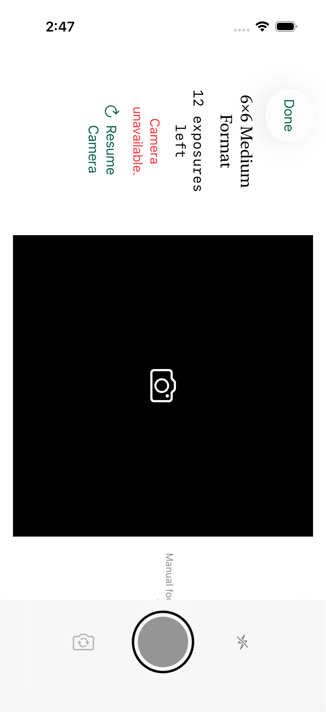
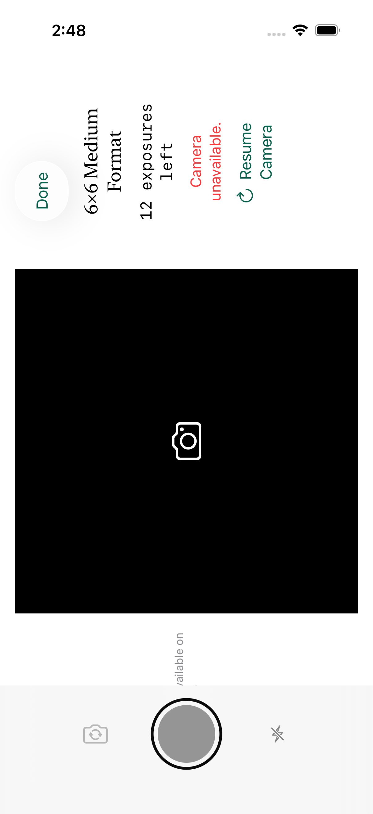
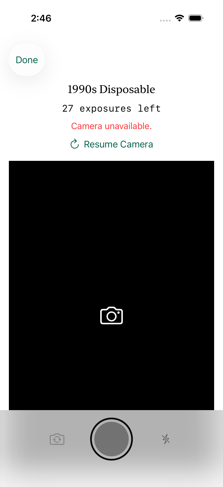
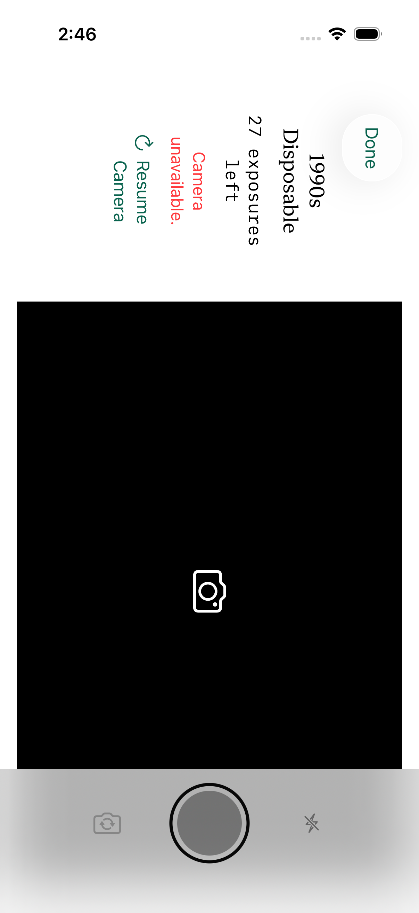
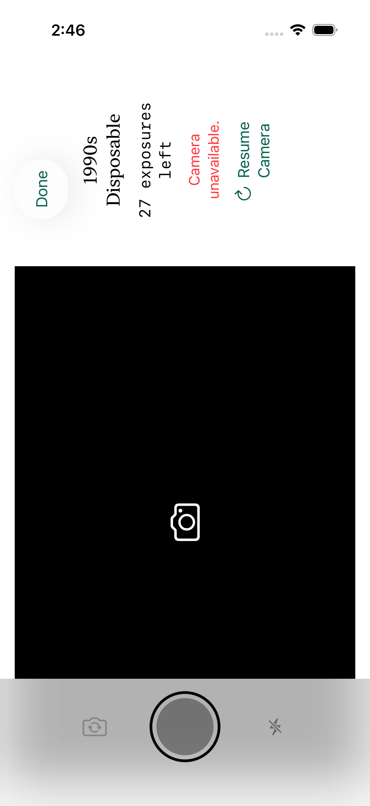
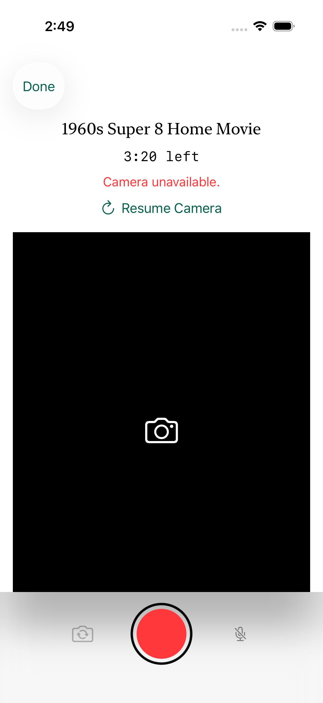
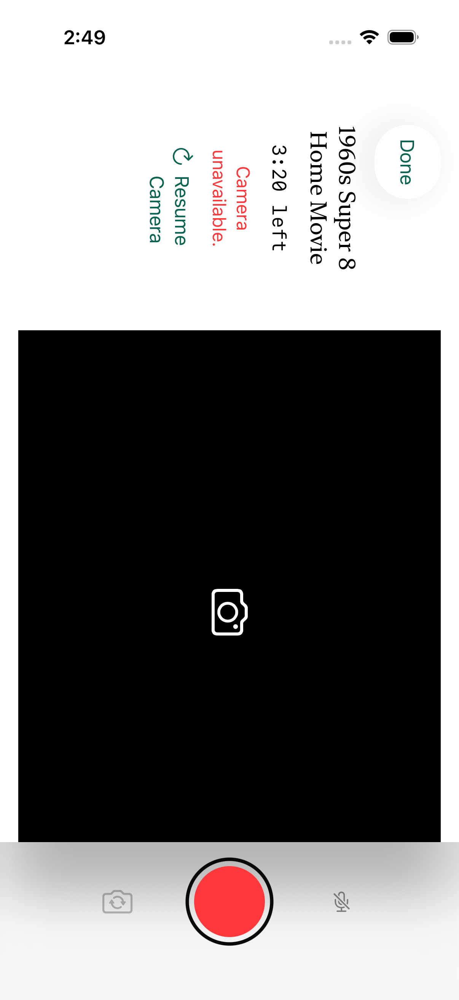
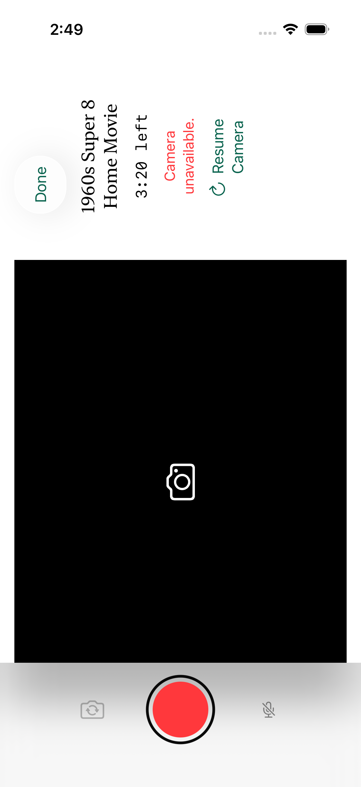
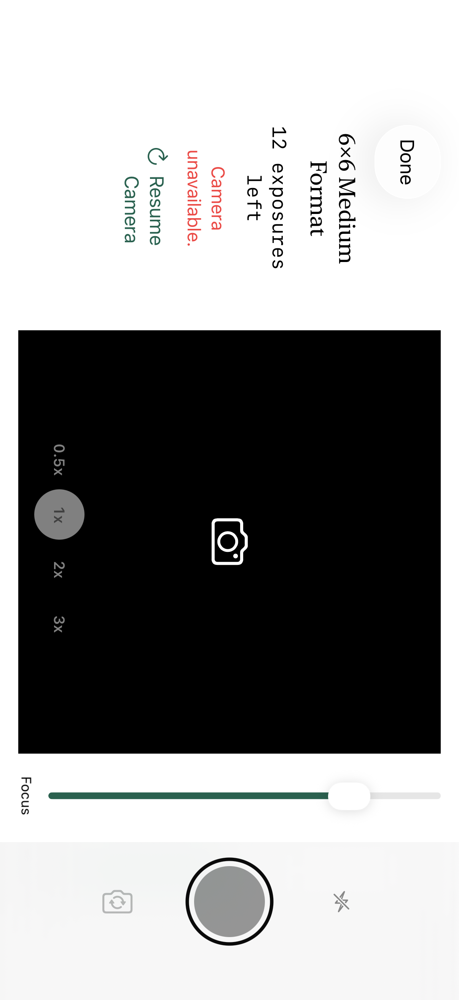

# The Shooting Screen Held Sideways, the Normal 6×6 Viewfinder and the 6×6's Zoom Steps 068

Captain (2026-10-16), after trying the build on his iPhone:

- "6x6 Viewfinder - normal viewfinder. No reverse"
- "All cameras landscape shooting. viewfinder does not fit the screen. viewfinder should be same size whether the user is shooting portrait or landscape style. Adjust the text when shooting so that its legible when shooting both styles"
- "6x6 - allow zoom as allowed by camera native (0.5x, 1x, 3x, 5x, etc.)"

What he saw, from his iPhone screenshot of a Camera held sideways: the whole shooting screen had turned with the iPhone, the viewfinder ran off the bottom of the screen behind the shutter bar, the Done button sat on top of the viewfinder, and the "7 exposures left" line was faint at the very top.
Asked how sideways shooting should work, he chose "Like iPhone Camera": the screen never turns, the viewfinder keeps the same spot and size, only the words and icons turn so they read upright, and the photo still saves sideways.

[ADR 0017](../../2026-09-29-film-camera-experience-v1/adr/0017-the-shooting-screen-never-turns-and-the-6x6-has-a-normal-viewfinder-and-native-zoom.md) records the three decisions, and the PRD, the tracker and the domain model were amended to match.

This record is simulator evidence only.
The simulator has no camera, so the live picture, the real lenses, a real zoom and the orientation of a saved photo were not seen.
No real iPhone has run it.

## What He Saw, and Why

Before this change `CaptureView` laid itself out for the interface orientation: a compact vertical size class gave a wide viewfinder in the same scroll view, under a navigation bar that held Done and above a shutter bar pinned to the bottom of the screen.
Held sideways on an iPhone there is little height, so a wide viewfinder could not fit between the bars, and the screen's text turned with the whole screen.
The same thing reproduces in a simulator on `main` at `ab6aaed`: a 6×6 Film's shooting screen with the iPhone turned to its left turns the whole screen to landscape, the square viewfinder shows only a sliver of black above the shutter bar, and the count and the Camera's name are left across the top ([before-6x6-held-sideways.png](capture-sideways-zoom-068/before-6x6-held-sideways.png)).
The 6×6's reversed rear viewfinder came from PRD version 2.0 (section 6.1, FR-03 and FR-04) and from `CaptureBehavior.reversesRearViewfinder`.

## The Change

**The screen.**
The shooting screen keeps the portrait layout in every hold, for all five Cameras (`App/Immerse/Sources/CaptureView.swift`).
It holds the window to portrait while it is on screen (`ImmerseAppDelegate` and `InterfaceOrientationLock.swift`), and lets go when it leaves, turning the window to how the iPhone is held then.
While an Instant print or the question about its original is over the camera, the hold is released, so those turn with the iPhone like every other screen, and the camera is held again when they close.
Every other screen turns as before, the Darkroom's landscape arrangement of [065](darkroom-landscape-side-by-side-065.md) included.
Upside-down portrait is not handled: the screen reads as if the iPhone were upright.

**The words and icons.**
With the iPhone on its side (`HeldTurn.swift`) they turn to read upright, the home-side-right hold (`landscapeLeft`) a quarter turn clockwise and the home-side-left hold (`landscapeRight`) a quarter turn counterclockwise.

- The header (Done, the Camera's name, what is left, the status, messages, **Open iPhone Settings** and **Resume Camera**) is one block.
  It is laid out as the portrait header it is, `headerLength` wide (128 pt at the default text size, scaled with Dynamic Type) and as tall as that makes it, then turned as a whole and put against the edge of the screen that is the top for the person holding the iPhone.
- The focus and exposure captions turn beside their sliders, which stay across the screen; the notes ("Manual focus unavailable on this lens", "Flash unavailable on this lens", "Fixed exposure unavailable on this lens"), the Disposable's low-light cue and the zoom steps turn as blocks.
- The Switch Camera, flash and microphone icons turn in place.
  The shutter is a circle and stays as it is.
- Done is a glass button of at least 44 pt, the first row of the header, scrolling with the content.
  It replaced the navigation bar's Done.

**The viewfinder.**
Its box is the Camera's portrait shape in every hold: square for the Instant and the 6×6, 2:3 for the Disposable, 3:4 for the Super 8 and the 16mm.
Inside it the live picture is the shape the Camera develops to as the iPhone is held, in the middle of the box: held on its side it is a landscape window (3:2 for the Disposable, 4:3 for the two Movie Cameras), and a square stays square.
The preview rotates with how the iPhone is held (`CaptureController.orientation`, the same angle a photo is saved with), no longer with the interface.
A clip keeps the orientation it started in, so neither the words nor the picture turn while a clip records.
Saved photos and clips are as they were: the orientation the iPhone was held in, never mirrored.

**The 6×6.**
`CaptureBehavior.reversesRearViewfinder` is gone and `isViewfinderMirrored` is true for the front camera only.
`CaptureBehavior.offersZoomSteps` is true for the 6×6.
Its Load Film note now reads "Zoom steps follow your iPhone's own lenses, as in its Camera app.", and the rear viewfinder's accessibility label is "Rear viewfinder" for every Camera; each zoom step is "Zoom" and its label spoken as "0.5 times", "1 times" and so on, with an identifier such as `zoom-0.5x`.
No other product string changed.

### What was rejected

- **The screen as it was, turned with the iPhone.**
  It is what his screenshot showed, and a second landscape arrangement would still change the viewfinder's size between holds.
- **Turning each line of text on its own.**
  A line turned in place takes as much height as it was wide, so the header's height would differ between holds and move the viewfinder.
  The header is turned as one block that reserves the greater of its two heights, so the viewfinder never moves.
- **Laying the header over the viewfinder.**
  It would have covered the picture, changed the portrait screen the captain had already seen, and at the largest text sizes covered most of it.
- **Turning the sliders.**
  A slider turned a quarter turn is only as long as the room under the viewfinder is tall, which is short for a manual focus control.
  The sliders stay across the screen and their captions turn beside them.
- **Pinning the header above the scroll view.**
  The first version did, and at the largest text size the header filled the whole screen and the viewfinder could not be reached.
  The header now scrolls with the content, and a turned header that is too long for the screen scrolls across it (which is up and down for the person holding the iPhone on its side), starting from its top.
- **A virtual multi-lens capture device with `videoZoomFactor`.**
  It is how the iPhone's Camera app zooms, but then manual focus, exposure bias and the capabilities the capture screen reads would describe the virtual device and not the lens in use, and the note "Manual focus unavailable on this lens" must stay true for each lens.
  Each step instead runs on its own physical lens as the session's input, swapped as a front and rear switch is.

### The header takes the same height in every hold

`TurnedBlock` measures its content both ways, upright at the width it is offered and turned at `headerLength`, and the header takes the greater height in every hold.
At the default text size the turned header is 128 pt, and where the upright header is shorter than that, as with only a Camera's name and its count under Done, the viewfinder sits a little lower held upright than a header sized to its text alone would put it.
That is the cost of a viewfinder that never moves.
The hosted test `testAHeaderThatReservesItsLengthIsTheSameHeightInEveryHold` holds it at 128 pt in all three holds, 358 pt wide.
`TurnedBlock` uses `ViewThatFits` only to choose between the turned header and a copy of it that scrolls across the screen, which happens when the turned header is wider than the screen.
`AGENTS.md` prefers a custom `Layout` to `ViewThatFits` because `ViewThatFits` swaps view identity as text grows; here the swap happens only when a turned block outgrows the screen, and nothing in the header holds state that the swap would lose.

### The 6×6's zoom steps

The steps follow what the iPhone's camera interface reports (`ZoomSteps.swift`, `AVFoundationAdapters.swift`):

1. The lens list and each lens's label come from the rear virtual device (triple, dual wide or dual camera), which is only read: each lens's factor is its switch-over zoom factor times `displayVideoZoomFactorMultiplier`, which is how the iPhone's Camera app labels them.
2. A native sensor-crop step of the wide lens is added only where the camera interface reports one, from the wide lens's active format (`secondaryNativeResolutionZoomFactors`, the zoom factors at which the camera "produces high-fidelity, non-upsampled images" beyond 1.0x), read once the session runs on its photo preset.
   It is dropped where a real lens already gives that factor.
3. Fewer than two steps means no zoom control at all.

| The iPhone's rear lenses, as the camera reports them | A native crop reported | Steps shown |
| --- | --- | --- |
| One wide lens | none | none |
| One wide lens | 2x | 1x, 2x |
| Ultra wide (0.5x), wide (1x) | none | 0.5x, 1x |
| Ultra wide, wide, telephoto at 3x | none | 0.5x, 1x, 3x |
| Ultra wide, wide, telephoto at 5x | none | 0.5x, 1x, 5x |
| Ultra wide, wide, telephoto at 5x | 2x | 0.5x, 1x, 2x, 5x |
| Ultra wide, wide, telephoto at 3x | 2x | 0.5x, 1x, 2x, 3x |
| Ultra wide, wide, telephoto at 2.5x | none | 0.5x, 1x, 2.5x |
| Wide (1x), telephoto at 2x | 2x | 1x, 2x, the 2x being the telephoto lens |

Each is a case of `ZoomStepTests`, built from injected lens capabilities.

**Why a crop step only where reported.**
A sensor crop is not a lens, and a crop that the camera does not call native is a digital enlargement, which the PRD's rule that a control be "genuinely supported by the active phone lens" and the captain's "as allowed by camera native" both exclude.
So the app never offers a step between steps, never a pinch, and no crop the camera does not report.

**How a step is taken.**
`AVFoundationCaptureBackend.selectZoomStep` is allowed only by `CaptureSessionPlan.zoomDecision`: the 6×6 only, the rear camera only, a step the iPhone reports, and only when the backend is idle (refused while a photo saves, a clip records or saves, or the camera is interrupted).
A step on another lens swaps the session's input; a native crop sets the wide lens's `videoZoomFactor`.
The focus behavior and the person's Focus position are held on the new lens, so the Focus slider is there where the lens can focus by hand and the note is there where it cannot.
Every lens is returned to its own zoom factor when a session starts or switches, because a lens keeps its zoom between sessions and Cameras, and every start and every switch back to the rear begins on 1x.
The control is dimmed while the camera is busy.

**What each step does to the picture's detail.**
Development center-crops every capture to a square and scales it to 3072 by 3072 for the 6×6 (`NativePhotoRenderer.develop`), whichever lens took it and however the iPhone was held, so a saved 6×6 picture is the same square at the same size at every step; a capture whose short side is under 3072 pixels is scaled up slightly, as every 6×6 capture was before.

- The ultra wide and the wide lens keep their own sensors' pixels over their own fields of view.
- The telephoto lens uses its own sensor's pixels over a narrower field of view; nothing is enlarged digitally to reach it.
- A native crop step uses the wide lens's `videoZoomFactor` at the factor the camera reports as non-upsampled, with the photo settings the other lenses use.
  Whether that photo has the full native resolution of the crop, and how its detail compares with the telephoto lens at the same factor, was not measured: it is for a phone ([H06](manual-validation.md#h06---the-zoom-steps-on-this-iphone) and [H08](manual-validation.md#h08---the-6x6-picture-at-every-zoom-step)).

## What Holds It

| Check | Where |
| --- | --- |
| Behavior per Camera: no Camera reverses its rear viewfinder, every front viewfinder is mirrored, only the 6×6 offers zoom steps | `CaptureBehaviorTests` |
| Zoom steps derived from injected capabilities (one lens, wide plus ultra wide, three lenses at 3x and at 5x, a dual camera, 2.5x, crops reported or not, duplicates, order, labels), and the zoom decision: only the 6×6's rear camera, refused while saving, recording, saving a clip or interrupted, an unreported step and a Camera without zoom refused | `ZoomStepTests` |
| The held turn follows how the iPhone is held; a block reserving its length is the same height in every hold; a turned block takes the room it needs; a block that does not reserve takes its turned footprint | `CaptureSidewaysTests` (hosted) |
| Every Camera's shooting screen held upright and on each side at the default and the largest text size, with the lens controls and low-light cue a lens would raise, kept as screenshots | `CaptureSidewaysTests.testCaptureScreensHeldSidewaysKeepTheLayoutAndTurnTheText` |
| On the 6×6, the Disposable and the Super 8, in a simulator turned upright, to its left and to its right: the window stays portrait; the viewfinder's and the shutter's frames are identical in all three holds; the count turns to read upright; Done keeps a 44 pt target, stays on screen, clear of the viewfinder and of the count; and after Done the Film screen turns with the iPhone | `CaptureSidewaysUITests` |
| The 6×6's Load Film note and its text measured at all 12 sizes | `JournalIntegrationTests`, `ContentSizeTests` |

The screen tests tap Done with the iPhone held upright: XCTest taps in the device's frame, and with the iPhone on its side over a portrait interface a tap on Done did not reach it.
Only after the camera has closed is the simulator turned to its side, which shows that the hold ended with the screen.

### Runs

`swift test --package-path Packages/NativeAdapters` passed (58 tests, 15 of them the new `ZoomStepTests`).
On an iPhone 17 simulator on iOS 26.5, every `ImmerseTests` test passed (61 tests, 6 of them the new `CaptureSidewaysTests`) except the four StoreKit tests, which need the iOS 26.2 fixture simulator that validation boots for them and fail on any other simulator with "Local StoreKit fixture is not active".
The three `CaptureSidewaysUITests` passed on the same simulator, 4 minutes 37 seconds together, and so did the Load Film text tests at the extra small, large and largest sizes and the 6×6's extra-small Load audit, whose copy changed, and the landscape Settings test, which a hold that leaked would break.
`CaptureSidewaysTests` ran on an iPhone SE (3rd generation) simulator too.
The Release build, with the Debug-only hooks (`CaptureController.hold(forTesting:)`) compiled out, passed `Scripts/verify-release-excludes-testing-unlock.sh`, and the Populated Journal Harness, which compiles the app's sources, builds.

### Failures on the way, kept

- A hosted test of a block that outgrows the screen compared a 337.67 pt height with 337.5 and failed by a rounding to the screen's pixels; the widening of a block that outgrows the screen, which it tried to hold, was replaced by the scrolling copy, and the test went with it.
- The first screen test also asserted that the viewfinder ends above the shutter bar.
  That is not true of the Disposable's 2:3 box or the 4:3 boxes, which are taller than the screen, so their lower part scrolls under the bar when the header grows, as it did before this change; the assertion was removed.
- The first screen test measured a turned Done as 34 pt wide, under a 44 pt target; its label now has a minimum height of 44 pt.
- The first screen test tapped Done sideways and the camera stayed open, which is the XCTest frame behavior above.
- Every turned block first took the full width it was offered and sat against the screen's top edge, so the zoom steps and the low-light cue landed on the wrong edge of the viewfinder.
  Only the header fills the width now; any other block is as wide as it is tall once turned, and its parent puts it where it belongs.
- The hosted screenshot test turned the test host's own window: closing a hosted shooting screen turns the window to how the iPhone is held, which the test had set, and the later hosted Darkroom tests then ran in a landscape window and failed (four tests, until the test closed each screen with the iPhone upright and waited for SwiftUI to report it gone).
- The screen tests do not run on an iPhone SE simulator: the shared `tapWhole` helper keeps 40 pt clear of the window's bottom edge for the home indicator, and the SE has none, so Load Film's button never counts as whole on screen there.
  The SE was checked in the hosted screenshots instead (the header, the viewfinder, the zoom steps and the notes, upright and on each side, at the default size), which showed nothing clipped or overlapping; the viewfinder's frame was not measured on the SE.

## Pictures

Simulator screenshots of the shooting screen.
The simulator has no camera, so each viewfinder shows its empty frame and the screen shows the message for the missing camera; the zoom steps, the sliders and the cue appear only where the hosted test raises what a lens would report.

| | Upright | Top to the left | Top to the right |
| --- | --- | --- | --- |
| 6×6 |  |  |  |
| Disposable |  |  |  |
| Super 8 |  |  |  |

| The 6×6's zoom steps turned, over the viewfinder | The 6×6 at the largest text size, turned |
| --- | --- |
|  |  |

In each row the viewfinder's box is the same size in the same place in all three holds; the header's block turns to the edge that is the top for the person holding the iPhone, with Done at its top.

## Not Proven Without a Phone

All of these are for the manual iPhone test plan ([H01 to H10](manual-validation.md#the-sideways-shooting-screen-and-the-zoom-steps-on-a-real-iphone)), which belong to the build that follows the pending camera changes:

- The live picture: that it is upright and the right shape in the viewfinder in each hold and on each Camera, and that what the window frames is what saves.
- The saved photo's and clip's orientation when taken sideways, and a clip keeping the orientation it started in when the iPhone turns while it records.
- Real lens switching and real zoom steps, and the labels on each iPhone model: the lens list and factors are read from the camera interface and were exercised only with injected capabilities.
- Whether a native crop step is reported, on which iPhones and at which factors, and its detail; and the detail of the telephoto lens in the 6×6's square.
- Manual focus and exposure bias on each lens, and which lenses show the note "Manual focus unavailable on this lens".
- That a zoom step tapped while a photo saves is refused and the photo is from the lens that took it.
- That the 6×6 opens on 1x each time and that no other Camera opens zoomed after it.
- The orientation hold on a physical iPhone, including tapping Done while the iPhone is on its side, opening the camera on its side, and what it does with Portrait Orientation Lock on.
- The turned text in the hand: legibility, where the header lands against the edge, and the zoom pill over a live picture, and the Disposable's cue over a live picture.
- The 6×6's rear viewfinder not reversed, and the front viewfinder still mirrored, on real lenses.
- The Darkroom and an Instant print turning with the iPhone after the camera was used.
- Display Zoom and VoiceOver on the shooting screen held sideways.
