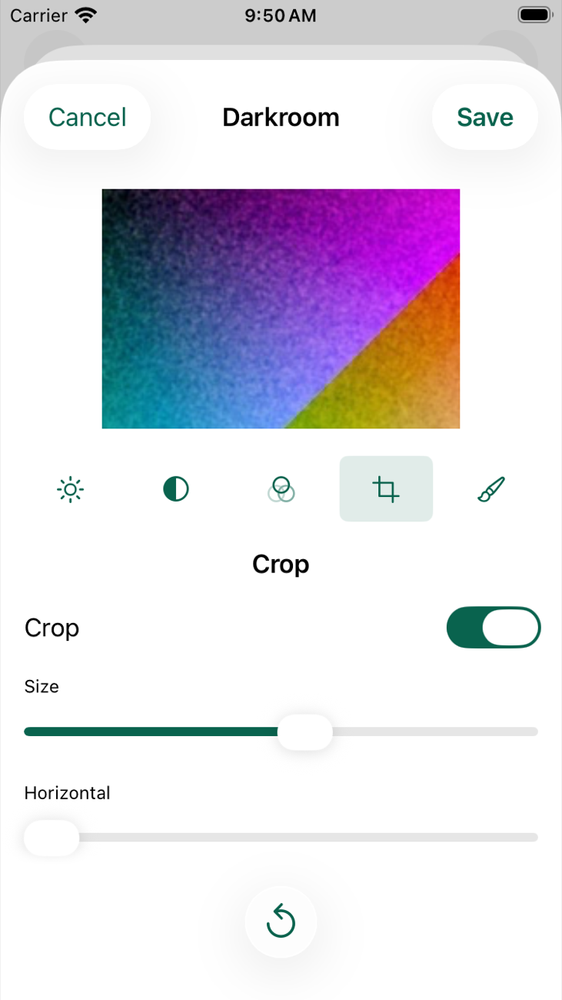
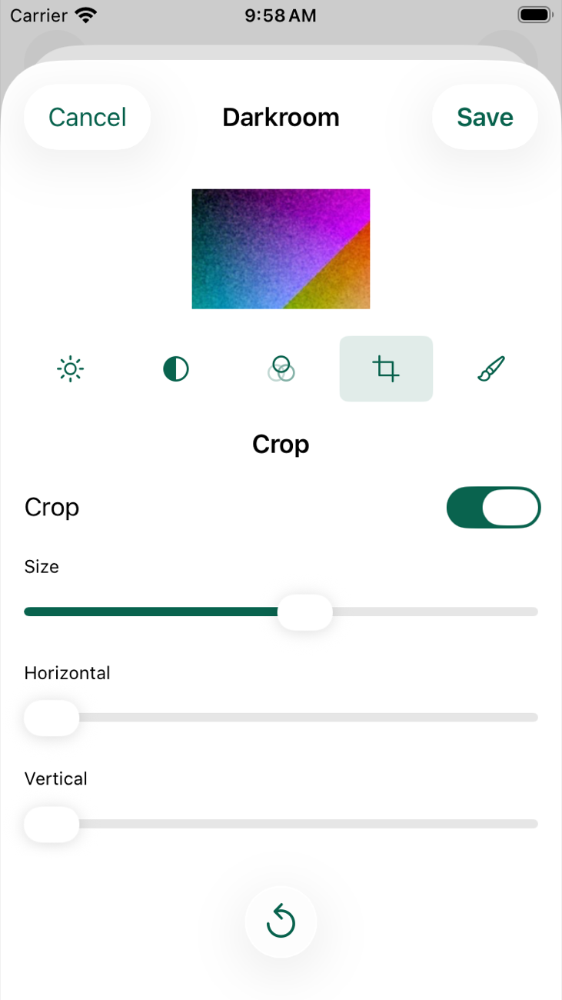
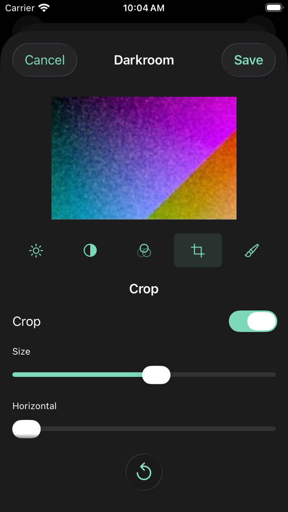
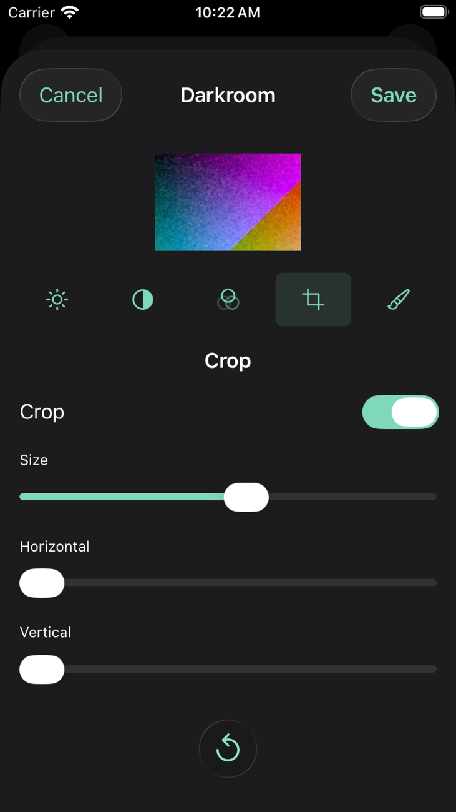
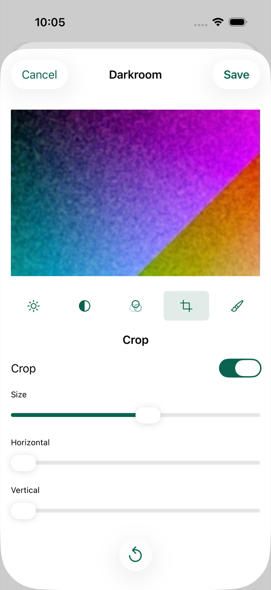
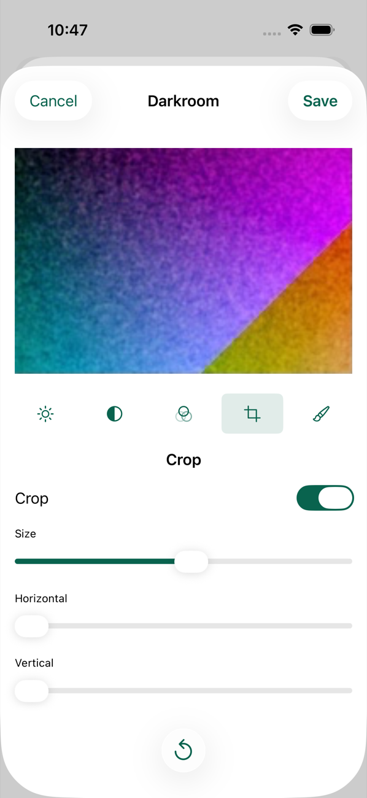
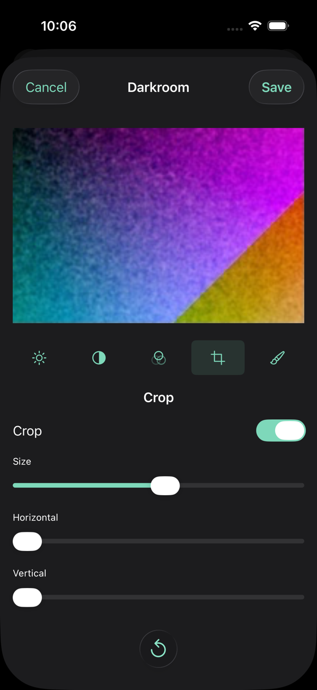
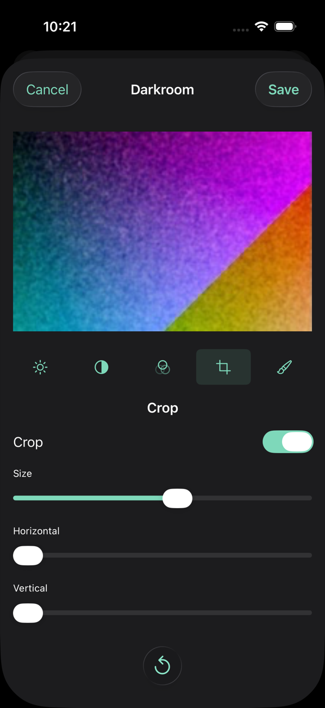
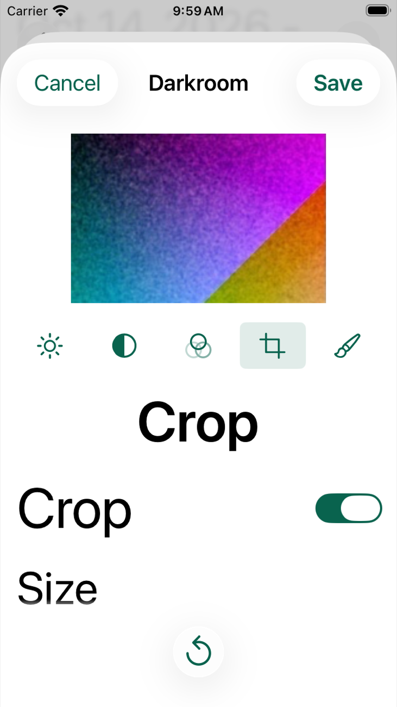
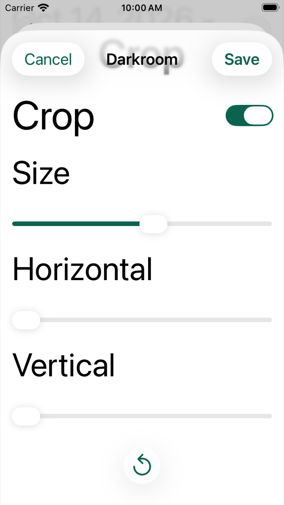

# Crop Fits a Short Screen 063

Captain (2026-10-14): "immerse crop fit".
He was answering a finding from testing the Darkroom change of 2026-10-13, older than that change: on an iPhone SE with the Crop tool open and a crop smaller than the whole print, the Vertical slider rests wholly below the bottom of the screen under the Reset to Original bar, and nothing shows that more is below.
One drag up reveals it and it works, and the iPhone 17 Pro shows all three sliders.
The options put to him were to shrink the print a little on small screens so all three sliders fit ("crop - fit"), a small "more below" hint ("crop - hint"), or leaving it ("crop - leave").
His choice: on short screens the print gives up some height in the Crop tool so all three sliders show.

This record is simulator evidence only.
No real iPhone has run it.

## Reproduction

An iPhone SE (3rd generation) simulator on iOS 26.5, at the default text size, a Disposable print, the Crop tool open, the Crop switch on and the Size slider at 0.6.
The print rested at its smallest ordinary size, 160 pt.
The scroll area stopped at 577 pt, above the Reset to Original bar, and its last 12 pt fade out, so a control in full view ends by 566 pt.
The Horizontal slider ended at 574 pt, half in the fade, and the Vertical slider lay at 614 to 645 pt, under the Reset button at 596 pt.
The new screen test (below) failed there in light and in dark: the Vertical slider was not hittable and a drag sent to it moved nothing.
On the iPhone 17 Pro the same test passed before the change, with the Vertical slider at 741 to 772 pt and Reset at 803 pt.

## The Change

`DarkroomLayout` (`App/Immerse/Sources/PhotoView.swift`) takes `fitsEveryControl`, which the Darkroom sets for the Crop tool only.
With it, the print may go below its ordinary smallest size of 160 pt, down to 64 pt, where that rests every control on screen.
Where even a 64 pt print would leave controls below the fold, the print keeps 160 pt and the screen scrolls exactly as before.
Where everything already fits, as on the iPhone 17 Pro, the print is the height the controls leave, as before, so nothing changes.
Every other tool keeps the rule it had, and the explanation of an error still takes its height from the print down to 80 pt.
Nothing in rendering, recipes, saved prints or product text changed.

On the iPhone SE at the default text size, the print in the Crop tool with a crop smaller than the whole print is now 80 pt tall, 120 by 80 pt for the Disposable's 3:2 picture.
The Vertical slider rests at 534 to 565 pt, inside the clear part of the scroll area, above Reset to Original.

### Why 64 pt

The Crop controls need the iPhone SE's print to come down to a fraction of a point under 80 pt.
The 80 pt an error already allows is therefore just too much: with 80 pt as the floor, the test still failed with the print at 160 pt.
64 pt, two fifths of the ordinary 160 pt, leaves the SE's default text size a margin of about 16 pt and still shows the cropped print at a size whose framing can be judged.
A smaller floor would only let a larger text size fit too, with a print too small to judge the crop by; there the screen scrolls instead.

## What Holds It

- `testDarkroomRestsEveryCropControlOnScreenAtTheDefaultSize` (populated harness, the check's harness part) opens Crop on a Disposable print, turns the crop on, moves Size to 0.6, and checks with nothing scrolled that the switch, the heading, the three sliders and their captions all rest between the navigation bar and the fade, above Reset to Original, that the print is below the bar, above the controls and at least 64 pt tall, and that the Vertical slider is hittable and takes a drag.
  It then turns the crop off, returns to Exposure and checks that the print has the height it had before Crop opened.
- `testDarkroomScrollsTheCropControlsClearAtTheLargestSize` does the same at the largest text size, where the controls cannot all fit: the Vertical slider is scrolled to with held drags, comes fully clear of the fade, and takes the drag.
- `testTheCropToolsPrintGivesUpHeightOnlyWhereEveryControlThenFits` (hosted, `JournalIntegrationTests`) holds the rule in `DarkroomLayout` itself: controls that leave 120 pt keep the print at 160 pt without `fitsEveryControl` and give it 120 pt with it, the print keeping its top edge; controls that would leave it under 64 pt keep 160 pt; and where everything fits, every frame is as without it.

CI creates only iPhone 17 Pro simulators, where everything fits, so the check runs the new screen tests there; the iPhone SE runs below are this record's.

## Runs

An iPhone SE (3rd generation) and an iPhone 17 Pro simulator on iOS 26.5, made for this task and deleted after it.

| Check | Result |
| --- | --- |
| `testDarkroomRestsEveryCropControlOnScreenAtTheDefaultSize` on the code before the change, iPhone SE in light and in dark | Fails: Horizontal ends at 574 pt and Vertical at 645 pt against 566 pt, the Vertical slider is not hittable and does not take the drag |
| The same test on the code before the change, iPhone 17 Pro in light and in dark | Passes |
| The same test with a floor of 80 pt, iPhone SE in light | Fails as before: the print stays 160 pt |
| The two new screen tests, the Darkroom fit tests at the default and the largest text size for the Disposable, the Instant and both 6×6 Film Stocks, both explanation tests, `testDarkroomExposureAndDodgeBurnReachThreeStopsAndSave`, `testInstantPrintShowsItsCardAndTheDarkroomOffersNoCrop`, `testBlackAndWhite6x6PrintTakesChemicalToning`, `testEarlyPhotoDevelopmentDarkroomAndRemoval`, and the retained `testDarkroomAccessibleControlsReachNonGestureEditingPaths`, `testSavedDarkroomEditAndExactResetPersistAcrossRelaunch` and `testDrawnDodgeStrokeChangesPrintAndPersistsAcrossRelaunch` | 19 passed, 0 failures, on the iPhone SE in light and in dark and on the iPhone 17 Pro in light and in dark |
| The new hosted test and `testADarkroomErrorTakesItsHeightFromThePrintAndLeavesTheControlsInPlace`, iPhone SE | 2 passed, 0 failures |
| `Scripts/verify-validation-parts.sh` | Pass |

The Darkroom has no accessibility audit of its own: the fit tests are its text-size checks and `testDarkroomAccessibleControlsReachNonGestureEditingPaths` is the check of its controls, as `darkroom-export-decisions-060.md` says.
The text-size suite (`ContentSizeTests`), the audits of other screens, the package tests and the rest of the screen tests were not run here; they are the check's to run.

## Pictures

The Crop tool with a crop smaller than the whole print, at the default text size.

| iPhone SE in light, before | After |
| --- | --- |
|  |  |

| iPhone SE in dark, before | After |
| --- | --- |
|  |  |

On the iPhone 17 Pro the print is at 162 pt and the Vertical slider at 741 pt before and after, in light and in dark.

| iPhone 17 Pro in light, before | After |
| --- | --- |
|  |  |

| iPhone 17 Pro in dark, before | After |
| --- | --- |
|  |  |

At the largest text size on the iPhone SE the print keeps 160 pt and the controls scroll, as before.

| iPhone SE, largest text, at rest | Scrolled to the Vertical slider |
| --- | --- |
|  |  |

## Not Shown Here

- A real iPhone SE or any physical iPhone.
- Text sizes between the default and the largest, other than through the rule: there the print shrinks if a print of 64 pt or more then shows every Crop control, and otherwise stays 160 pt with the screen scrolling.
- VoiceOver on a device.
