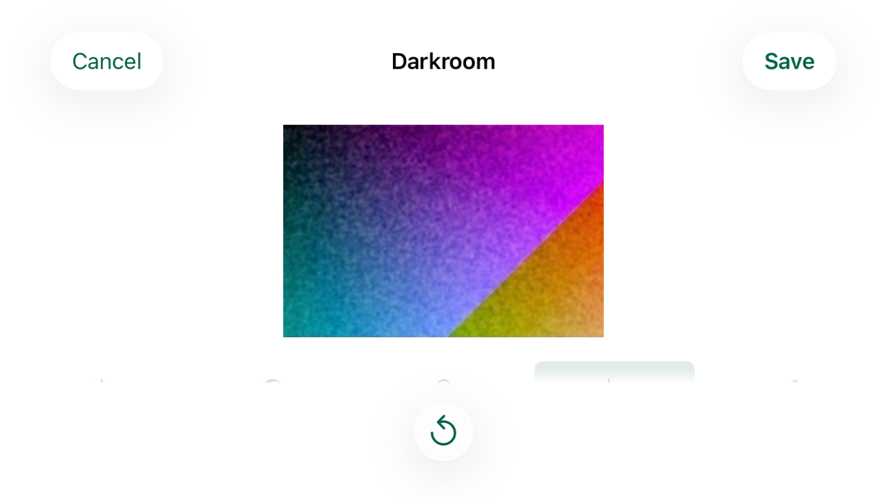
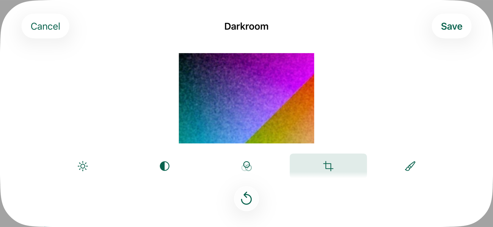

# Crop Fits a Short Screen 063

Captain (2026-10-14): "immerse crop fit".
He was answering a finding from testing the Darkroom change of 2026-10-13, older than that change: on an iPhone SE with the Crop tool open and a crop smaller than the whole print, the Vertical slider rests wholly below the bottom of the screen under the Reset to Original bar, and nothing shows that more is below.
One drag up reveals it and it works, and the iPhone 17 Pro shows all three sliders.
The options put to him were to shrink the print a little on small screens so all three sliders fit ("crop - fit"), a small "more below" hint ("crop - hint"), or leaving it ("crop - leave").
His choice: on short screens the print gives up some height in the Crop tool so all three sliders show.

This record is simulator evidence only.
No real iPhone has run it.

## Reproduction

An iPhone SE (3rd generation) simulator on iOS 26.5, at the default text size, a Disposable print, the Crop tool open, the Crop switch on and the Size slider at 0.6.
The print rested at its smallest ordinary size, 160 pt.
The scroll area stopped at 577 pt, above the Reset to Original bar, and its last 12 pt fade out, so a control in full view ends by 566 pt.
The Horizontal slider ended at 574 pt, half in the fade, and the Vertical slider lay at 614 to 645 pt, under the Reset button at 596 pt.
The new screen test (below) failed there in light and in dark: the Vertical slider was not hittable and a drag sent to it moved nothing.
On the iPhone 17 Pro the same test passed before the change, with the Vertical slider at 741 to 772 pt and Reset at 803 pt.

## The Change

`DarkroomLayout` (`App/Immerse/Sources/PhotoView.swift`) takes `fitsEveryControl`, which the Darkroom sets for the Crop tool only.
With it, in portrait (a regular vertical size class), the print gives up height below its ordinary smallest size of 160 pt, down to 64 pt, to rest every control on screen.
Where even a 64 pt print leaves controls below the fold, the print stays 64 pt and the screen scrolls only the points still missing, so a larger text size never gets a larger print.
The scroll area still ends above Reset to Original, so no control rests under it and none is clipped.
Where everything already fits, as on the iPhone 17 Pro in portrait, the print is the height the controls leave, as before, so nothing changes.
In landscape (a compact vertical size class) nothing changes on any iPhone: the Crop tool keeps the ordinary rule, so its print is the 160 pt every other tool shows there and switching tools never moves it.
Every other tool keeps the rule it had, in which the explanation of an error takes its height from the print down to 80 pt; in the Crop tool the floor is 64 pt with or without an error.
Nothing in rendering, recipes, saved prints or product text changed.

On the iPhone SE at the default text size, the print in the Crop tool with a crop smaller than the whole print is now 80 pt tall, 120 by 80 pt for the Disposable's 3:2 picture.
The Vertical slider rests at 534 to 565 pt, inside the clear part of the scroll area, above Reset to Original.

### Why 64 pt

The Crop controls need the iPhone SE's print to come down to a fraction of a point under 80 pt.
The 80 pt an error already allows is therefore just too much: with 80 pt as the floor, the test still failed with the print at 160 pt.
64 pt, two fifths of the ordinary 160 pt, leaves the SE's default text size a margin of about 16 pt and still shows the cropped print at a size whose framing can be judged.
A smaller floor would only let a larger text size fit too, with a print too small to judge the crop by; there the screen scrolls instead.

### No Step Back to 160 pt

The first version of this change kept the print at 160 pt wherever a 64 pt print could not rest every control.
Review on 2026-10-14 found the step that left: the iPhone SE's default text size fits with about 16 pt to spare, and one or two sizes larger the heading and the three captions grow past that, so the print would jump back to 160 pt and put the Vertical slider wholly under Reset to Original again, the finding the captain answered.
The floor now holds: the print shrinks to 64 pt and stays there as the text grows, and the screen scrolls only the points still missing.

### Portrait Only

That floor, applied whenever the Crop tool was open, also reached landscape, where a 64 pt print still leaves the Crop controls below the fold on every iPhone.
There it gave up the print's height without showing every slider, and switching between Crop and Exposure moved the print between 64 and 160 pt.
Review on 2026-10-14 kept the floor to portrait: in landscape the Crop tool keeps the ordinary rule, as every other tool does.

## What Holds It

- `testDarkroomRestsEveryCropControlOnScreenAtTheDefaultSize` (populated harness, the check's harness part) opens Crop on a Disposable print, turns the crop on, moves Size to 0.6, and checks with nothing scrolled that the switch, the heading, the three sliders and their captions all rest between the navigation bar and the fade, above Reset to Original, that the print is below the bar, above the controls and at least 64 pt tall, and that the Vertical slider is hittable and takes a drag.
  It then turns the crop off, returns to Exposure and checks that the print has the height it had before Crop opened.
- `testDarkroomScrollsTheCropControlsClearAtTheLargestSize` does the same at the largest text size, where the controls cannot all fit: the print is 64 pt, and the Vertical slider is scrolled to with held drags, comes fully clear of the fade, and takes the drag.
- `testTheCropToolsPrintGivesUpHeightForItsControlsDownTo64Points` (hosted, `JournalIntegrationTests`) holds the rule in `DarkroomLayout` itself: controls that leave 120 pt keep the print at 160 pt without `fitsEveryControl` and give it 120 pt with it, the print keeping its top edge; controls that would leave it 63 pt give it 64 pt, with the controls ending 1 pt past the scroll area's clear part; and where everything fits, every frame is as without it.
- `testTheCropToolsPrintKeeps64PointsPastTheLargestTextSizeThatFits` (hosted) gives the stand-in controls the height that leaves the print 80 pt at the default text size, as the Crop tool's do on an iPhone SE, and steps the text size up to the largest: the print never grows, and at the two sizes past the largest whose controls all fit it is 64 pt, never 160 pt, with the controls running past the clear part by exactly the points they still need.
- `testTheCropToolsPrintKeepsTheOrdinaryFloorInLandscape` (hosted) gives `DarkroomLayout` a compact vertical size class: with controls that would leave the print 120 pt and then 63 pt, every frame with `fitsEveryControl` is the frame without it, the print 160 pt.
- `testDarkroomCropKeepsThePrintInLandscape` (populated harness) opens Crop on a Disposable print, turns the crop on and moves Size to 0.6 in portrait, turns the simulator to landscape, and checks that the print in Crop has the height and place Exposure then gives it.
  The crop is set in portrait so nothing is scrolled: in landscape a drag down at the top of the Darkroom pulls its sheet away.

CI creates only iPhone 17 Pro simulators, where everything fits in portrait, so the check runs the new screen tests there; the iPhone SE runs below are this record's.

## Runs

An iPhone SE (3rd generation) and an iPhone 17 Pro simulator on iOS 26.5, made for this task and deleted after it.

| Check | Result |
| --- | --- |
| `testDarkroomRestsEveryCropControlOnScreenAtTheDefaultSize` on the code before the change, iPhone SE in light and in dark | Fails: Horizontal ends at 574 pt and Vertical at 645 pt against 566 pt, the Vertical slider is not hittable and does not take the drag |
| The same test on the code before the change, iPhone 17 Pro in light and in dark | Passes |
| The same test with a floor of 80 pt, iPhone SE in light | Fails as before: the print stays 160 pt |
| The two new screen tests, the Darkroom fit tests at the default and the largest text size for the Disposable, the Instant and both 6×6 Film Stocks, both explanation tests, `testDarkroomExposureAndDodgeBurnReachThreeStopsAndSave`, `testInstantPrintShowsItsCardAndTheDarkroomOffersNoCrop`, `testBlackAndWhite6x6PrintTakesChemicalToning`, `testEarlyPhotoDevelopmentDarkroomAndRemoval`, and the retained `testDarkroomAccessibleControlsReachNonGestureEditingPaths`, `testSavedDarkroomEditAndExactResetPersistAcrossRelaunch` and `testDrawnDodgeStrokeChangesPrintAndPersistsAcrossRelaunch` | 19 passed, 0 failures, on the iPhone SE in light and in dark and on the iPhone 17 Pro in light and in dark |
| The new hosted test and `testADarkroomErrorTakesItsHeightFromThePrintAndLeavesTheControlsInPlace`, iPhone SE | 2 passed, 0 failures |
| `Scripts/verify-validation-parts.sh` | Pass |

### Again after the merge with main

The branch was brought up to main after the low-storage warning (062) landed, which changed app code and screen tests beside this change but not the Darkroom.
On the merged code, on new iPhone SE (3rd generation) and iPhone 17 Pro simulators on iOS 26.5:

| Check | Result |
| --- | --- |
| The 19 Darkroom screen tests above | 19 passed, 0 failures, on the iPhone SE in light and in dark and on the iPhone 17 Pro in dark |
| The harness part, `IMMERSE_VALIDATE_PART=harness sh Scripts/validate-local.sh`, iPhone 17 Pro in light | 44 passed, 0 failures, no test rerun |
| The two hosted Darkroom layout tests, iPhone SE | 2 passed, 0 failures |
| The text-size part, `IMMERSE_VALIDATE_PART=ui-text`, iPhone 17 Pro | Pass |
| The screen-flows part, `IMMERSE_VALIDATE_PART=ui-flows`, iPhone 17 Pro | The light pass passed (23 tests and the expected audit failure); the dark rerun of the audits failed two tests, below |
| `Scripts/verify-validation-parts.sh` | Pass |

The two failures in the dark rerun are outside the Darkroom, which no test of that part opens:

- `LowStorageUITests.testFilmScreenWarningAtTheLargestTextSizeHidesNoControl` ran past its 3-minute allowance while this Mac was loaded far beyond its cores by other work; run again alone in dark it passed.
- `MovieCapacityUITests.testMovieTimeReadsAsMinutesAndSecondsAtLargestText` failed its contrast audit on the Journal, on the title of a Disposable Film left by `LowStorageUITests`, which runs before it, fading under the screen's bottom edge.
  It failed the same way when the two ran again together, and passed run alone with the app freshly installed.
  Main's own check of the low-storage warning passed that part in the same order on GitHub's Apple silicon Macs, so it shows only on this Intel Mac.
  It is main's to look at, not this change's.

Main's check of the low-storage warning failed its harness part on `RetainedWorkflowTests.testDarkroomAccessibleControlsReachNonGestureEditingPaths`, older than this change: the tap on the Crop switch left it off, and the Crop size slider never appeared.
The test's own snapshots and recording show the switch resting in its final place, its tool row settled, for more than a second before the tap.
Here that test passed in every run above, before and after the merge, and the Crop switch was at rest when it first existed; why that one tap did nothing is not known, and nothing was changed for it.

The package tests on a Mac and RenderCore's tests in the simulator were not run again: the change touches no package, and the merge brought no package change that meets it.

### Again after review

The floor of 64 pt that holds as the text grows ("No Step Back to 160 pt", above), on new iPhone SE (3rd generation) and iPhone 17 Pro simulators on iOS 26.5, in light:

| Check | Result |
| --- | --- |
| The two hosted Crop layout tests on the rule before review, iPhone 17 Pro | Both fail: the print is 160 pt where 64 pt is expected; with the text growing it is 67 pt at accessibility1, then 160 pt at accessibility2 and accessibility3 |
| The two hosted Crop layout tests and `testADarkroomErrorTakesItsHeightFromThePrintAndLeavesTheControlsInPlace`, iPhone SE | 3 passed, 0 failures |
| The two Crop screen tests, iPhone SE and iPhone 17 Pro | 2 passed, 0 failures on each; at the largest text size the print is 64 pt on both |
| `Scripts/verify-document-package.sh` | Pass |

Dark was not run again, since the rule reads no color; the largest-text pictures below are from this run.

### Again after the landscape review

The floor kept to portrait ("Portrait Only", above), on new iPhone SE (3rd generation) and iPhone 17 Pro simulators on iOS 26.5, in light:

| Check | Result |
| --- | --- |
| `testTheCropToolsPrintKeepsTheOrdinaryFloorInLandscape` and `testDarkroomCropKeepsThePrintInLandscape` on the rule before this review, iPhone SE | Both fail: in landscape the Crop tool's print is 120 pt and then 64 pt in the hosted test, and 64 pt against Exposure's 160 pt in the Darkroom |
| The four hosted Darkroom layout tests, iPhone SE | 4 passed, 0 failures |
| `testDarkroomCropKeepsThePrintInLandscape` and the two Crop screen tests at the default and the largest text size, iPhone SE and iPhone 17 Pro | 3 passed, 0 failures on each |
| `Scripts/verify-document-package.sh` | Pass |

The Darkroom has no accessibility audit of its own: the fit tests are its text-size checks and `testDarkroomAccessibleControlsReachNonGestureEditingPaths` is the check of its controls, as `darkroom-export-decisions-060.md` says.
The text-size suite and the audits of other screens ran on the merged code (above); the package tests were left to the check.

## Pictures

The Crop tool with a crop smaller than the whole print, at the default text size.

| iPhone SE in light, before | After |
| --- | --- |
|  |  |

| iPhone SE in dark, before | After |
| --- | --- |
|  |  |

On the iPhone 17 Pro the print is at 162 pt and the Vertical slider at 741 pt before and after, in light and in dark.

| iPhone 17 Pro in light, before | After |
| --- | --- |
|  |  |

| iPhone 17 Pro in dark, before | After |
| --- | --- |
|  |  |

At the largest text size on the iPhone SE the print is 64 pt and the controls scroll.

| iPhone SE, largest text, at rest | Scrolled to the Vertical slider |
| --- | --- |
|  |  |

In landscape the Crop tool shows the print at 160 pt, as Exposure does, and the controls scroll as before.
On the iPhone SE the tool row then rests half in the scroll area's fade, as it does in every tool; this change leaves landscape as it was.

| iPhone SE in landscape, Crop open |
| --- |
|  |

| iPhone 17 Pro in landscape, Crop open |
| --- |
|  |

## Not Shown Here

- A real iPhone SE or any physical iPhone.
- Text sizes between the default and the largest in the real Darkroom, other than through the rule and its hosted test: there the print shrinks as far as 64 pt to show every Crop control, and past that stays 64 pt with the screen scrolling the rest.
- Landscape at any text size but the default, and the turn between portrait and landscape with the Crop tool open, other than through the rule.
- VoiceOver on a device.
