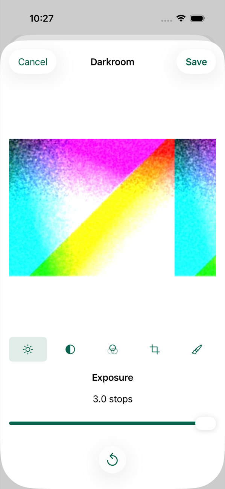
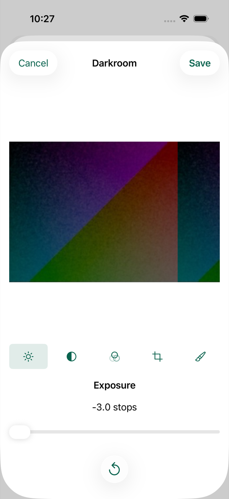
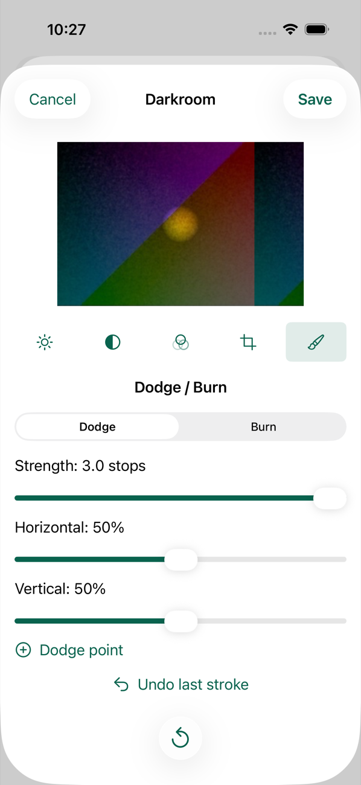
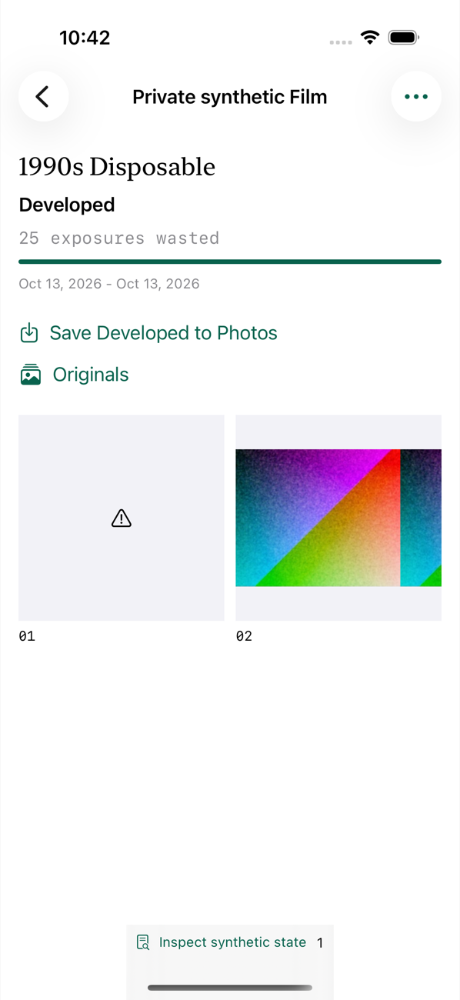
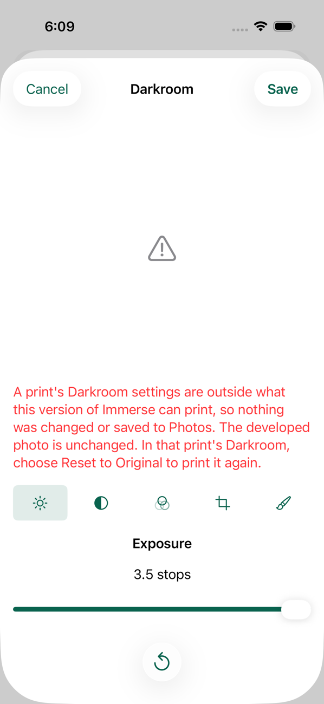
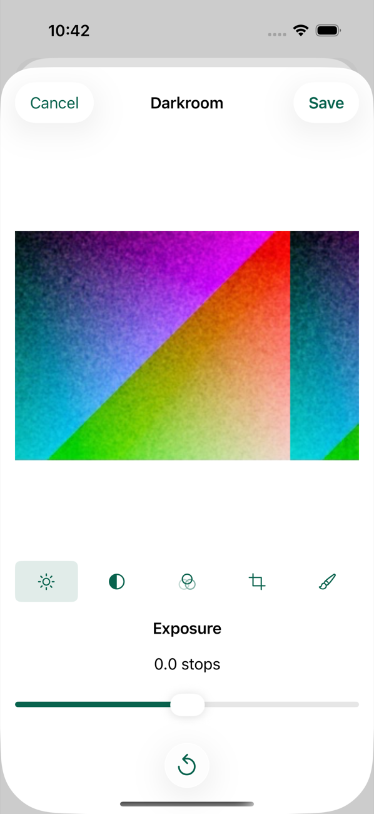
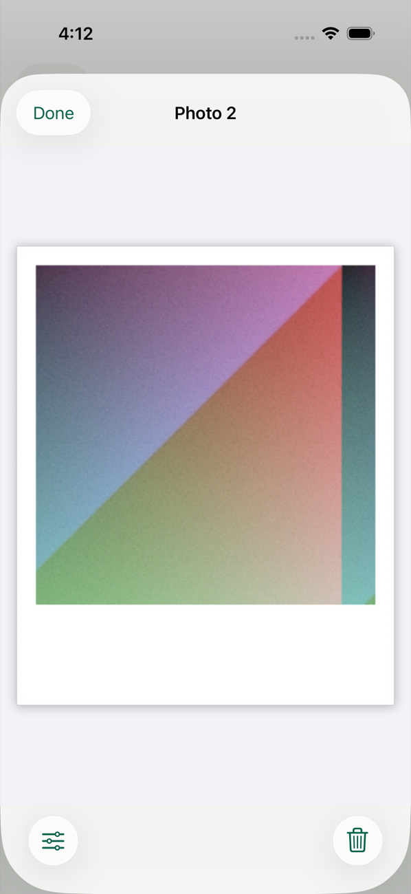
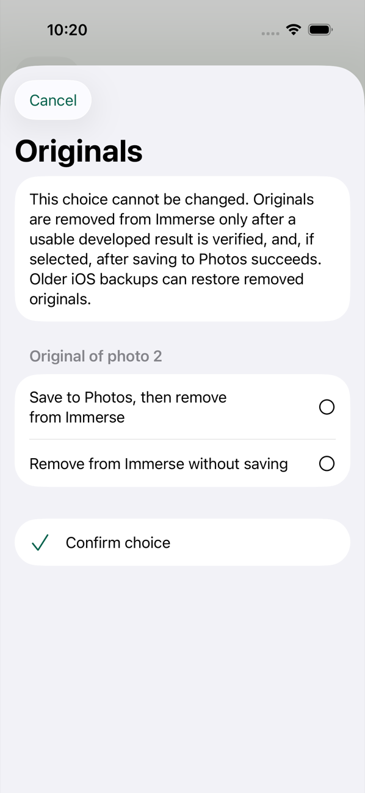

# The captain's 2026-10-13 decisions in the app (060)

**Date:** 2026-10-13.
**Scope:** DEC-04 (export sizes and formats), DEC-05, DEC-11, DEC-12, DEC-13 and DEC-14.
The Instant's contrast and print-to-print variation and the toning strength are a separate task.

What he was asked, in the words he read, and what he said are in the 2026-10-13 addendum to the [open-decision recommendations](../../2026-09-29-film-camera-experience-v1/2026-09-29-film-camera-experience-v1-open-decision-recommendations.md).
This note records what the app does about each answer, the choices made in carrying them, what was run, and what was not.

Everything here ran on a Mac and an iPhone 17 Pro simulator on iOS 26.5.
The tables below say what was run before the merge with main and what was run again after it.
Nothing ran on a phone.

## Darkroom limits (DEC-11)

His answer: "looks good. can we change the exposure, dodge and burn to plus and minus 3 stops?"

| Control | Limit | Where |
| --- | --- | --- |
| Print exposure | -3.0 to +3.0 stops, in tenths | `DarkroomLimits.printExposureStops` |
| Dodge and Burn | -3.0 to +3.0 stops | `DarkroomLimits.localExposureStops` |
| Color filtration | -30 to +30, whole units | `DarkroomLimits.colorFiltration` |
| Contrast | Grades 0 to 5 | `DarkroomLimits.contrastGrades` |
| Crop | Per photo; the 6×6 square; none for an Instant print | `NativePhotoRenderer.validate` |
| Reset | The developed master's own bytes | `NativePhotoRenderer.print` |

`DarkroomLimits` (`Packages/RenderCore/Sources/RenderCore/DarkroomRecipe.swift`) is the one home of the numbers.
The validator, the renderer and the Darkroom's sliders read them from it.

### Three choices made in carrying it

He was shown the limits, not their workings, so these are named in the addendum as his to see.
The addendum's list also names the Instant's question (below) and the two Development fixes found while reading the exports back (under Exports).

1. **A strength slider for Dodge and Burn.**
   Every stroke used to be 0.4 stops, with no control.
   A limit of 3 stops needs a way to reach it, so a stroke now has a strength of 0.1 to 3.0 stops, starting at 0.4.
2. **Overlapping strokes stop at 3 stops together.**
   Strokes add up where they overlap, each working on the print as the last left it.
   Left unbounded, a few overlapping 3-stop strokes ran past what the renderer can hold, and the print came out as a ring with a dark middle, not as white or black.
   The renderer now keeps every part of the print within 3 stops of its print exposure after each stroke, so "plus and minus 3 stops" is true of the print and the picture stays defined however many strokes there are.
   It was seen with eight overlapping 3-stop dodges followed by eight burns; at the earlier 0.4 stops a stroke the same total would have taken sixty strokes.
3. **A stored value outside the limits is refused, not clamped.**
   See below.

### The ends

`DarkroomLimitsTests` (RenderCore) prints a chart of 24 flat patches, 12 grays and 12 colors:

- Print exposure at -3 and +3 puts every patch where the arithmetic of stops puts it, clipped at white, to within 3 of the 255 levels.
- Each other control at each end, alone and with exposure, contrast, filtration and a 3-stop stroke all at an end together, prints a whole picture of the right size whose patches stay flat and whose grays stay in order.
  Toning at none and full is included for black-and-white prints, and a crop at its smallest in each corner.
- Exposure and Dodge and Burn at their ends together: 6 stops from the developed print where they agree, none where they oppose, the rest of the print at the print exposure, and a smooth edge between.
- Sixty overlapping 3-stop strokes print the stroke's middle where one does, and eight dodges followed by eight burns stay within 3 stops everywhere.
  Without the bound that test fails: the middle of sixty dodges prints 255 where one dodge prints 38.

The populated harness drives the real Darkroom (`testDarkroomExposureAndDodgeBurnReachThreeStopsAndSave`): the exposure slider reaches "3.0 stops" and "-3.0 stops" and speaks "plus 3 stops" and "minus 3 stops", the strength slider reaches "3.0 stops", a 3-stop dodge on a print 3 stops down shows in the print, the recipe saves and comes back.

| Plus 3 stops | Minus 3 stops | Minus 3 stops with a 3-stop dodge |
| --- | --- | --- |
|  |  |  |

### A recipe saved under the earlier limits

It opens and prints the same bytes.
`DarkroomLimitsTests.testARecipeSavedUnderTheEarlierLimitsPrintsTheSameBytes` keeps the earlier build's printing unchanged in the test (`EarlierDarkroom`) and compares it byte for byte with today's, for 14 recipes at and inside the earlier limits on a Disposable print, each with and without a crop, two toned black-and-white prints and two Instant prints.
`StoredRecipeLimitsTests` reads the stored form the earlier build wrote through the production repository and prints it.

One difference exists and is deliberate.
A recipe with eight or more overlapping strokes of the same kind on one spot, more than 3 stops together, now prints that spot at 3 stops.
Seven overlapping 0.4-stop strokes, 2.8 stops, print as before, and the test holds that.

### A stored value outside the limits

The Darkroom cannot make one.
Only a build with wider limits, or a damaged store, can leave one.

What the app does (`StoredRecipeLimitsTests`, and by hand in the simulator with a stored exposure of 3.5 stops):

- The recipe is read as it was stored, and nothing clamps it.
- The print is refused wherever it would be made.
  The Film screen shows a warning mark in its place.
  Its Darkroom opens, says the settings are outside what this version can print, and offers Reset to Original.
  Saving the same recipe again is refused.
- Save Developed to Photos checks every recipe before it writes anything, so it stops with nothing saved.
- The developed master and every other print are untouched.
- Reset to Original, saved, prints the developed master again, byte for byte.

This handling is kept by the task's decision.
The task asked for this state to be defined and tested, and this is the least that keeps it honest for the person holding the phone: the print says it cannot be made and why, Reset to Original prints it again, and an export stops before anything is saved to Photos.
It is named in the addendum as his to see.

| The Film screen | Its Darkroom | After Reset to Original |
| --- | --- | --- |
|  |  |  |

### If this change is reverted

A recipe saved at the wider limits then meets the earlier build, whose limits are 2 stops and 1 stop.
This was run against a copy of that build (commit `5c3a217`), with stored exposures of 3 and -2.5 stops and a 3-stop stroke:

- It refuses the print the same way (`invalidRecipe`), and the Film screen shows the warning mark.
- Its message is its general one, about checking storage, which misleads here.
- Its Save Developed to Photos does not check first: with the print second of three, one photo reached Photos before it stopped.
- The developed master is unchanged, the other prints print, and Reset to Original brings the print back.

So a revert loses no picture.
A user with such a recipe would reset that print's Darkroom edit, or move its sliders back inside the earlier limits, to see it again.

## The Instant asks about each print's original (DEC-11)

Before, nothing asked: the choice was only under Originals on the Film screen.

Now the screen a print is revealed on asks about its original, once:

- At the camera the print is shown first.
  Closing it brings the question, about that print only.
- When one Development reveals more than one print at the camera, each is shown in the order it was taken, and closing each brings the question about that print before the next is shown.
  None is asked about before it has been shown, none twice, and none is skipped.
- On the Film screen, a print revealed by Resume Development, or one that lands after the camera was closed, is asked about there.
  Prints revealed together there are asked about in one question, as they were before review.
- Left unanswered, the choice waits under Originals.
  A print revealed while neither screen is open is not asked about and waits there too.
- Choosing to save writes the original to Photos when the choice is confirmed, because the print is already revealed.
  If Photos refuses, the choice stands and can be tried again from the same sheet or from Originals.
- A sealed frame is never asked about, and an answer for one print leaves every other print's original as it was.
- A print discarded from the sheet that revealed it at the camera closes with no question, and no earlier print is shown or asked about in its place.

| The print, revealed at the camera | The question that follows |
| --- | --- |
|  |  |

Run: the hosted `testTheInstantAsksOnlyAboutRevealedPrintsWithNoRecordedChoice`, and three populated harness tests, at the camera screen (`--reveal-at-camera`, which develops the sealed print once the camera screen is open, as the app does when a save lands there), on the Film screen, and left unanswered.
The retained inspector checks that the answered print's original is gone and the other print's original and choice are untouched.
Two more harness tests were added in review (see After review): `testInstantPrintDiscardedAtTheCameraBringsNoEarlierPrintAndNoQuestion`, and `testInstantShowsAndAsksAboutEachOfTwoPrintsRevealedTogetherAtTheCamera`, which adds `--two-sealed` so that the one Development reveals two prints.
The picture of the revealed print above was taken again in review, because the first one had the simulator's Camera request lying over the print.

Not run: a real capture.
The simulator has no camera, so the save that leads to the reveal was stood in for; saving an original to Photos was not run either, since the harness has no Photos access.

## A soundtrack can be changed later (DEC-11)

The shipped catalog carried the rule as a setting with two possible values and no choice between them, so the Soundtrack control could never appear.
The rule is now the app's one behavior and the setting is gone.

`SoundtrackTests.testASoundtrackCanBeChangedLaterAnyNumberOfTimesWithoutDevelopingAgain` changes a developed Movie's soundtrack five times through a new processor, as after a relaunch.
After each change the Movie has the right audio and length, the Developed Clips' bytes and records and the Development run are unchanged, and no clip was rendered.

The shipped catalog is still empty, so no soundtrack is offered (DEC-05).

## Exports (DEC-04)

His answers: the sizes and formats as put to him, and then, asked about the Instant's size and Movie color, "instant export size: A,  leave Movies as they are".

`ApprovedExportTests` saves each Camera's developed results as Save Developed to Photos does and reads the files handed to Photos:

| Camera | Read back from the exported file |
| --- | --- |
| 1990s Disposable | JPEG, sRGB, 4032 × 2688 from the phone's 12-megapixel capture (2688 × 4032 turned), 4242 × 2828 from a 27-megapixel one; always 3:2 and never more than 12,000,000 pixels |
| 6×6 Medium Format | JPEG, sRGB, 3072 × 3072, both Film Stocks |
| 1970s Instant | JPEG, sRGB, 2282 × 2774; unedited, the developed print byte for byte |
| 1960s Super 8 Home Movie | H.264 in a `.mov`, 1920 × 1440 and 1440 × 1920, 18 frames a second, no audio track, no color tags |
| 16mm Cinema | The same at 24 frames a second, both Film Stocks |

The app already wrote these.
Reading the files back found two differences, both fixed for what is developed from now on:

1. **A pixel over 12 megapixels.**
   A capture larger than the limit developed a Disposable picture of 2829 × 4243, 12,003,447 pixels, because a fractional size rounded outward.
   It is now brought down to whole pixels, 2828 × 4242.
   The phone's own 12-megapixel capture develops at 4032 × 2688 as before.
2. **A sliver frame at every cut.**
   A Developed Clip began one more frame in the time left after its last whole frame, so each clip ended on a frame lasting a fraction of a frame.
   A one-second Super 8 Movie of two clips read back at 19.9 frames a second.
   A clip is now its whole frames, with the last held to where the recording stopped, so the Movie still lasts exactly as long as was recorded and never reads above its Camera's frame rate.

Neither changes a picture or Movie already developed: masters and Developed Clips are stored and are not developed again, and assembly is unchanged.
Both change what is developed from now on, which he was not shown, so both are named in the addendum as his to see.
His "leave Movies as they are" answered the question about color tags, and none is added.
The second fix is kept because it is what makes the 18 and 24 frames a second he approved true of the file.

Two things are as they were and are worth knowing:

- A Movie file's clock ticks 600 times a second, which 18 does not divide, so Super 8 frames last 33 or 34 ticks in turn.
  The test holds each frame to within a tick of its place.
- Movie capture records the largest 4:3 format within 1920 × 1080, which is 1440 × 1080 on most phones, and Development enlarges it to 1920 × 1440.
  That capture size is still provisional (`MovieCaptureFormat`).

The proposal he chose from is kept as [`instant-export-size-proposal.md`](darkroom-export-decisions-060/instant-export-size-proposal.md), with the print it showed.

## Samples and music (DEC-05)

Nothing changes in the app: the shipped catalog is empty and rejects anything without production clearance.
It stays empty until he supplies his own shots, seven in all, and until a license allows a soundtrack inside exported Movies.

## Targets, wording and learning (DEC-12, DEC-13, DEC-14)

These are records, not code.

- The speed and storage targets are approved and none is measured, because no iPhone 11 is available.
- The warning below 2 GB free was approved on 2026-10-13 as a target.
  It is not built by this change, and it is not built anywhere yet: the app has no such warning.
  Building it is tracker task CAP-15, added unchecked with this change.
- The support and store wording is not written; only its approach is approved.
- No analytics exists in the app, and no learning targets are set.

## What was run

| Check | Result |
| --- | --- |
| `swift test --package-path Packages/RenderCore`, Mac | 106 tests, 1 skipped, 0 failures |
| The RenderCore tests inside the simulator, without `LegacyLookTests` | 102 passed, 1 skipped, 0 failures |
| `swift test --package-path Packages/FilmRuntime` | 64 tests, 0 failures |
| `FilmDomain`, `MediaCatalog`, `FilmPersistence`, `NativeAdapters`, `EntitlementCore` | 24, 4, 37, 39 and 6 tests, 0 failures |
| Hosted `ImmerseTests` (`JournalIntegrationTests`, `CaptureControllerIntegrationTests`, `TestingUnlockTests`), simulator | 43 tests, 0 failures |
| `ImmerseUITests`, the audits and text-size measurements, simulator in light | 76 passed and the one expected failure, 0 failures |
| Populated harness, the whole suite with the four tests named above, simulator | 33 tests, 0 failures |
| `Probes/TrialCommitStudy`, `Probes/DevelopmentProcessExit`; `AssetReviewGenerator` and `LookReviewBoards` build | Pass |
| The retained inspector's Instant checks, on the history that harness run left | Pass |
| The earlier build's handling of a recipe at the wider limits | Run once against a copy of commit `5c3a217`; not a kept test |

## After the merge with main

The branch was brought up to main (`d82c6fa`, the check split into four parts) with one merge commit.
Main changed no app code and no test of this change: only the workflow, the scripts, their tests and three documents.
This record was renumbered from 059 to 060 in that merge, because main's dropped-touch record took 059.

Run again on the merged code, as the `packages` part of `Scripts/validate-local.sh` (`IMMERSE_VALIDATE_PART=packages`), which holds every package test, the hosted app tests and the document checks:

| Check | Result on the merged code |
| --- | --- |
| The scripts' own tests (`Scripts/Tests`) | 52 tests, OK |
| `Scripts/verify-validation-parts.sh` | Pass; this change adds no package, probe, test target or screen-test suite |
| `Scripts/verify-requirement-map.sh` and `Scripts/verify-document-package.sh` | Pass |
| The eight packages on the Mac | Pass, with RenderCore at 106 tests (1 skipped) and FilmRuntime at 64 |
| `Probes/TrialCommitStudy` and `Probes/DevelopmentProcessExit`; `AssetReviewGenerator` built | Pass |
| The app built for the simulator and for a device; Release excludes the testing unlock | Pass |
| The RenderCore tests inside an iOS 26.5 simulator | 102 passed, 1 skipped, 0 failures |
| All of `ImmerseTests` inside an iOS 26.2 simulator, the StoreKit tests among them | 47 tests, 0 failures |

Carried over from the commit before the merge (`a83a8cc`), because the merge changed nothing they build or run: the populated harness (33 tests) and the app's screen tests (76 passed and the one expected failure).
The dark-appearance audits were not run by hand at either commit; the `ui-flows` part of the check runs them.

## After review

Review of this change found one defect and three places where the record was not exact.

The defect: discarding the print just revealed at the camera brought the print before it back up, and closing that asked about its original.
The camera took any change of the newest revealed print as a new reveal, and a discard makes an older print the newest.
It now takes only a print with a higher number than the newest it has seen revealed, so a discard shows and asks nothing.
The Film screen was not affected, because it compares sets of revealed prints and a discard only takes one away.

The record: the addendum no longer says that nothing in how a Developed Clip is written changes, its list of workings that are his to see has six entries, the handling of a stored value outside the limits is marked as kept, and the warning below 2 GB free has a tracker task, CAP-15.
No code changed for those three.

Run in review, on an iPhone 17 Pro simulator on iOS 26.5 made for the run and deleted after it:

| Check | Result |
| --- | --- |
| `testInstantPrintDiscardedAtTheCameraBringsNoEarlierPrintAndNoQuestion` on the code before the fix | Fails: "No earlier print is shown in its place" |
| The same test on the fixed code, with `testInstantAsksAboutTheOriginalOfThePrintRevealedAtTheCamera` and `testInstantOriginalQuestionLeftUnansweredWaitsUnderOriginals` | 3 passed, 0 failures |
| The new test three more times | 3 passed |
| `Scripts/verify-requirement-map.sh` | Pass, 137 intake IDs with CAP-15 |
| `Scripts/verify-document-package.sh`, after the documents ZIP was made again | Pass |

The new test waits for the print's sheet to come to rest before it taps Discard.
Its first form tapped while the sheet was still rising, and on one run iOS ignored that tap; the simulator's log held no dropped touch, and the screen recording showed the sheet in motion.

Nothing else was run again in review: the package tests, the hosted tests and the rest of the screen tests are the check's to run.

### The second round

A second round of review found three more things.

When one Development revealed two prints at the camera, only the later one was shown and asked about, and the earlier one was asked about on neither screen.
That happens when a print stays sealed, for example because the app went to the background while it developed, and the next shot's Development then reveals both.
The camera now keeps the prints revealed while it is open in the order they were taken, shows each, and asks about each when it is closed, before the next is shown.
The addendum's list of workings that are his to see gains a seventh entry for it.

`DevelopedMovieFormat.size(_:)`, a second statement of the Movie's frame size that nothing called, is removed.

The picture of the print revealed at the camera had the simulator's Camera request lying over the print.
A person does not meet that request at a reveal, because the app settles Camera access before a Film is loaded.
The camera tests now touch the print's title first, which lets XCTest answer a request that is up, and wait for the screen to be still.

Run in the second round, on an iPhone 17 Pro simulator on iOS 26.5 made for the round and deleted after it:

| Check | Result |
| --- | --- |
| `testInstantShowsAndAsksAboutEachOfTwoPrintsRevealedTogetherAtTheCamera` on the code before the fix | Fails: "Print 2 is shown at the camera"; only print 3 was on screen |
| The same test on the fixed code, with the single-print test, the discard test and `testInstantOriginalQuestionLeftUnansweredWaitsUnderOriginals` | 4 passed, 0 failures |
| The single-print test once more, with the simulator's Camera request reset so that it is up when the print is revealed | Passed; XCTest answered the request at the touch on the title, and the picture above is from this run |
| `Scripts/verify-requirement-map.sh` | Pass |
| `Scripts/verify-document-package.sh`, after the documents ZIP was made again | Pass |

The harness build compiled RenderCore without the removed helper.
No package test was run again in this round.

## Not shown here

- How the wider ranges feel under a finger, which is his to judge on a phone.
- A real export to Photos, and a Movie played from Photos.
- Whether color tags would change how a Movie looks on a phone.
  He chose to leave Movies untagged, and this is to be looked at during the manual iPhone test.
- Any of the DEC-12 targets.
