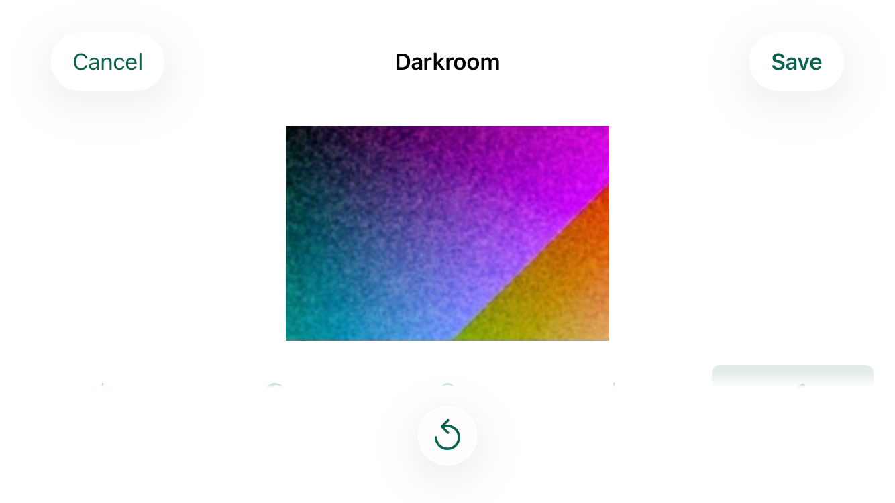
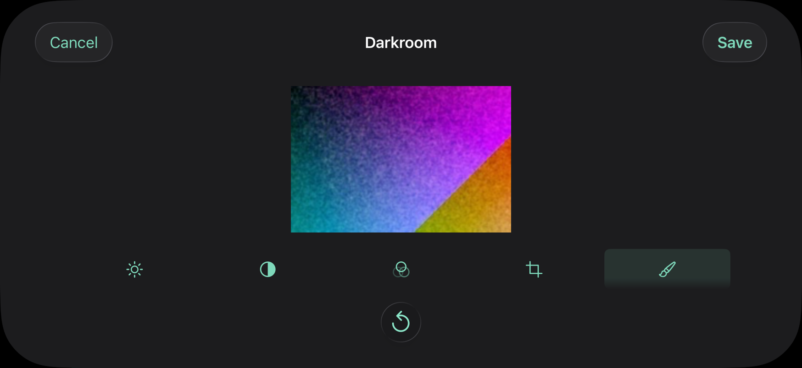
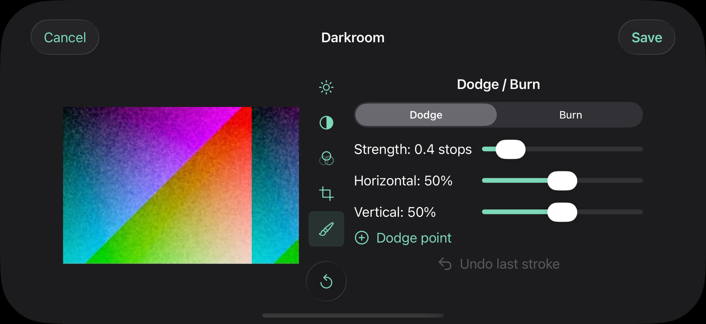
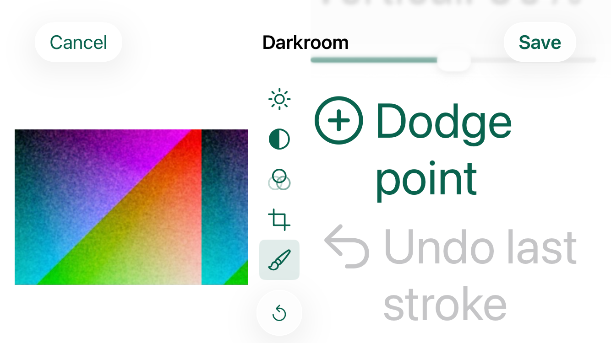
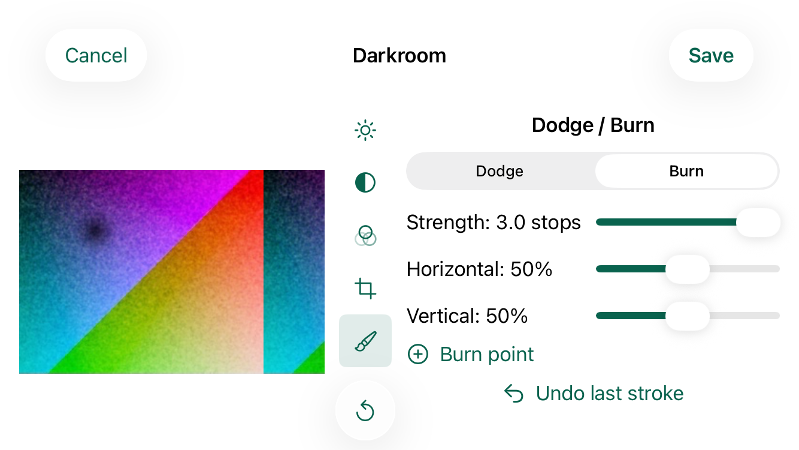
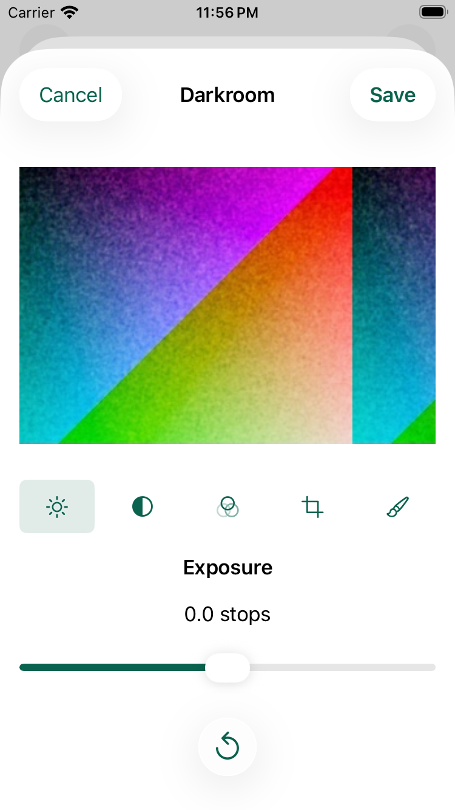
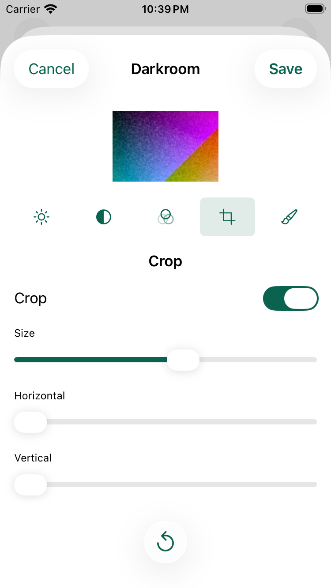

# The Darkroom Side by Side in Landscape 064

Captain (2026-10-14): "landscape - side by side".
He was answering a finding from the review of the Crop fit (`crop-fit-short-screens-063.md`), older than that change: on a small iPhone held sideways, the Darkroom pushes its tool buttons almost entirely off the bottom of the screen, so only the tops of the icons show and switching tools is hard.
The options put to him were side by side (when the iPhone is sideways, the print sits next to the controls instead of above them, so everything fits), a smaller print for every tool when sideways, or leaving it.
He chose side by side.

This record is simulator evidence only.
No real iPhone has run it.

## Reproduction

An iPhone SE (3rd generation) simulator on iOS 26.5, at the default text size, a Disposable print, the Darkroom opened in portrait and turned to landscape with each tool selected.
The navigation bar ends at 78 pt and the screen at 375 pt.
The floating Reset to Original bar takes the bottom 86 pt, so the scroll area ends at 289 pt.
Every tool showed a 160 pt print, 241 by 160 pt, with the tool row at 272 to 316 pt: 6 pt of its 44 pt in the clear, 12 pt fading out, and the rest, most of each icon, hidden behind the bar.
Below the row, every tool's controls lay wholly off the screen; Dodge / Burn's reached 687 pt.
The same happened in dark.

On the iPhone 17 Pro the scroll area ends at 316 pt, so the tool row shows but fades out at its foot, and no tool's controls show at all.

| iPhone SE in landscape, before | |
| --- | --- |
|  |  |

| iPhone 17 Pro in landscape, before | |
| --- | --- |
|  |  |

## The Change

`DarkroomLayout` (`App/Immerse/Sources/PhotoView.swift`) has two arrangements.
In portrait (a regular vertical size class) it is unchanged: the print above the tool row and the controls, Reset to Original in the floating bottom bar, and the Crop fit of 063.
In landscape (a compact vertical size class, every iPhone held sideways) it lays out, from the leading edge:

1. The print, as large as its column allows, centered in it, between 16 pt margins above and below.
2. The tool buttons in a column 44 pt wide, one 44 pt button each, with Reset to Original at its foot as the glass circle the bottom bar gave it, 50 pt across at every text size, as the bar keeps it.
3. The selected tool's heading and controls, in a column of their own that scrolls on its own when they cannot all show.

There is no bottom bar in landscape, so the whole height under the navigation bar is the Darkroom's.
The controls take 55% of the width the print and the controls share, which on the iPhone SE is 312 pt of content, and the print the rest.
Safe areas are kept on both sides: the arrangement sits inside them, so on the iPhone 17 Pro the Dynamic Island's side and the other side both keep their inset.

To fit Dodge / Burn, the longest tool, on the iPhone SE, two things change in landscape only:

- The space between the controls is 12 pt instead of portrait's 18 pt.
- A slider's caption sits beside it on one row instead of above it, and a tool's sliders line up after the longest caption (a grid).
  This is Dodge / Burn's Strength, Horizontal and Vertical, the Crop's Size, Horizontal and Vertical, and Filtration's Cyan, Magenta and Yellow.
  A caption whose value changes while its slider moves keeps the width of its widest value ("Strength: 3.0 stops", "Horizontal: 100%"), so the sliders never change length under a finger.
  Past the extra large text size a caption beside its slider would leave the slider too short, so there, as in portrait, the caption is above it and the column scrolls.

No product string changed, and nothing in rendering, recipes or saved prints did.

### Why the print goes on the leading side

- It keeps the portrait order: print first, then the tools, then the controls that change it.
  The accessibility tree lists them in that order too.
- The tools and the controls are on the trailing side, under the right thumb of most people holding the iPhone sideways.
- It is how editing a photo looks on an iPhone held sideways, the picture on the left and its tools on the right.

In a right-to-left language the arrangement would mirror, as SwiftUI's leading and trailing do; Immerse is in English only, so that was not run.

### Why the tools are a column and Reset sits at its foot

A tool row above the controls, as in portrait, costs 54 pt of a 297 pt column, and with it Dodge / Burn does not fit on the iPhone SE even with captions beside their sliders.
A column of five 44 pt buttons fits beside the controls at no height to them, between the print and the controls, as the spine between what is changed and what changes it.
Reset to Original cannot stay in the bottom bar, which takes 86 pt of the SE's height across the whole width; at the foot of the tool column it is where it was in portrait, at the bottom of the screen, with a 50 pt tap area.
Five tool buttons, Reset and the margins take 290 pt of the SE's 297 pt; where a column cannot hold them, the tools scroll and Reset stays.

### Turning the iPhone

The selected tool, the Dodge or Burn choice, the stroke strength and the recipe are the Darkroom's own state, so turning the iPhone keeps them; only the arrangement changes.
A Dodge / Burn stroke is recorded as fractions of the print it is drawn on, and a crop as fractions of the photo, so both land the same on the print whatever its size.
A stroke being drawn when the iPhone turns ends without its end, so its points are dropped rather than joining the next stroke.

## What Holds It

- `testDarkroomRestsExposureContrastAndFiltrationBesideADisposablePrintInLandscape`, `testDarkroomRestsDodgeBurnAndCropBesideADisposablePrintInLandscape` and `testDarkroomRestsChemicalToningBesideABlackAndWhite6x6PrintInLandscape` (populated harness, the check's harness part) open the Darkroom, turn to landscape and select those tools in turn, with the crop on and smaller than the print in Crop and Sepia chosen in Chemical toning, so every tool of the two Films is visited.
  For each tool, with nothing scrolled: every tool button and Reset to Original take a tap, are below the navigation bar and on screen, and rest whole inside the tools' column; every control of the tool and its heading rest on screen between the navigation bar and the fade, beside the tools, and take a tap; the print is below the bar, on screen, beside the tools and taller than 160 pt; and Reset takes a tap across at least 44 pt.
- `testDarkroomScrollsOnlyItsControlsInLandscapeAtTheLargestSize` opens Dodge / Burn in landscape at the largest text size: Undo last stroke starts below the fold, held drags in the controls column, started on none of its sliders or segments, bring it fully clear of the fade, the print, the tool buttons and Reset keep their frames and taps, every tool button rests whole in its column, Reset keeps its size, and Dodge point and Undo last stroke take their taps.
- `testDarkroomTurningKeepsTheStrokeAndStrokesLandWhereDrawn` draws a burn at the slider's strongest on the print in portrait, which darkens the print there and nowhere far from it; turned to landscape, Dodge / Burn, Burn, the strength and the stroke are kept, the stroke is undone there and a burn drawn at the opposite corner; turned back, the portrait print has the frame it had and is darkened at that corner only.
- `testDarkroomTurningKeepsTheCrop` sets a crop in landscape and turns back to portrait: the Crop tool, its three slider values and the cropped print's shape are kept.
- `testDarkroomCropKeepsThePrintInLandscape` (063) still holds: in landscape the Crop tool's print is Exposure's.
- `testInLandscapeThePrintSitsBesideTheControlsAndNothingInThemMovesIt` (hosted, `JournalIntegrationTests`, replacing 063's `testTheCropToolsPrintKeepsTheOrdinaryFloorInLandscape`, whose rule no longer applies) gives `DarkroomLayout` a compact vertical size class and holds the arrangement: the print at the leading margin and the full height between the margins, the 44 pt tool column 12 pt after it, the controls 12 pt after that to the trailing margin; controls three screens tall, the Crop fit, an error and the largest text size leave the print's frame as it was.
- The portrait tests, hosted and on screen, are unchanged but for the hosted error test's first check: its stand-in Darkroom now has a tool row, and the check finds it between the print and the stand-in controls, where the Darkroom has always had it.

CI creates only iPhone 17 Pro simulators, so the check runs these tests there; the iPhone SE runs below are this record's.

## Runs

An iPhone SE (3rd generation) and an iPhone 17 Pro simulator on iOS 26.5, made for this task and deleted after it.

| Check | Result |
| --- | --- |
| The reproduction, a test not kept that turned the Darkroom to landscape with each tool selected, on the code before the change, iPhone SE and iPhone 17 Pro in light and in dark | On the SE the tool row at 272 to 316 pt against a scroll area ending at 289 pt; on both, no control of any tool on screen |
| The six landscape screen tests (three tool tests, the largest text size, both turning tests) and 063's `testDarkroomCropKeepsThePrintInLandscape`, iPhone SE | 7 passed, 0 failures, in light and in dark |
| The same seven, iPhone 17 Pro | 7 passed, 0 failures, in light and in dark |
| The four hosted Darkroom layout tests, iPhone SE | 4 passed, 0 failures |
| The portrait Darkroom fit tests at the default size for the Disposable, the Instant and the black-and-white 6×6, the Disposable at the largest size and 063's Crop test at the default size, iPhone SE and iPhone 17 Pro, each in light and in dark | 5 passed, 0 failures, on each |
| The other twelve Darkroom screen tests (063's largest-size Crop test, the remaining fit and explanation tests, the three-stop, Instant, toning and early-Development tests and the three retained Darkroom tests), iPhone SE in light | 12 passed, 0 failures |
| The harness part, `IMMERSE_VALIDATE_PART=harness sh Scripts/validate-local.sh`, iPhone 17 Pro in light, before the turning test was split in two (below) | 50 passed, 0 failures, no test rerun |
| `Scripts/verify-validation-parts.sh` | Pass |

### Portrait unchanged

The portrait Darkroom tests attach the screen's element tree.
On the iPhone SE in light, the trees of the code before the change and after it were compared element by element for nine screens: Exposure and Dodge / Burn for the Disposable, the Instant and the black-and-white 6×6 at the default size, the Disposable at the largest size, and the Crop tool with a crop smaller than the print.
Every frame is the same to the point.
The one difference is a value, the Crop size slider at 0.653 before and 0.64 after, where XCUITest's slider adjustment lands a little differently from run to run.

### Failures on the way, kept

- The first landscape tool tests passed while the fifth tool button was cut at the foot of its column: its column's margins of 16 pt and Reset left the tools 265 pt for 272.
  `isHittable` needs only a button's center, so the tests now hold every button whole inside its column, and the column's margins are 8 pt.
- Reset to Original first measured 34 pt; a frame around a button does not widen what takes its taps.
  It is the large glass circle now, 50 pt, and the tests hold it to at least 44 pt.
- At the largest text size Reset grew to 81 pt and crowded the tools, so Dodge / Burn's button was cut.
  It now keeps the size the bottom bar keeps it at every text size, and the largest-size test holds the tools whole and Reset to its size.
- The first tool test ran every tool of a Film in one test and passed alone, but ran past the 3-minute allowance inside the harness part on this loaded Mac; it is three tests now, the longest about 80 seconds there.
  The turning test took 2 minutes in the harness part, so it is two tests now.
- On the iPhone 17 Pro, moving the strength slider to its end with XCUITest's adjustment gave 2.7 stops, not 3.0; the turning test now compares the strength it set, whatever it is.

The package tests on a Mac and RenderCore's tests in the simulator were not run: the change touches no package.
The text-size and screen-flow parts were not run: no test of theirs opens the Darkroom.

## Pictures

The Darkroom in landscape at the default text size, before the change, with Dodge / Burn selected, is under "Reproduction" above.
After it, on the iPhone SE the print is 255 by 170 pt for the Disposable's 3:2 picture and 255 pt square for the 6×6, against 241 by 160 pt before.
On the iPhone 17 Pro, inside its safe areas of 62 pt on either side, it is 292 by 195 pt and 272 pt square.

| iPhone SE in landscape, after | |
| --- | --- |
|  |  |
|  |  |
|  |  |
|  |  |

| iPhone 17 Pro in landscape, after | |
| --- | --- |
|  |  |
|  | |

At the largest text size on the iPhone SE, Dodge / Burn's controls scroll in their column; the print, the tools and Reset stay.

| At rest | Scrolled to Undo last stroke |
| --- | --- |
|  |  |

Turning, on the iPhone SE: a burn drawn in portrait shows in landscape, and a burn drawn in landscape at the lower right shows there on the portrait print.

| Turned to landscape | Turned back to portrait |
| --- | --- |
|  |  |

Portrait on the iPhone SE in light, before and after the change: the same.

| Before | After |
| --- | --- |
|  |  |
|  |  |

## Not Shown Here

- A real iPhone SE or any physical iPhone, held and turned in the hand.
- How the print and the controls side by side feel to use on a phone: the slider lengths beside their captions (154 pt for Dodge / Burn's on an iPhone SE), and a thumb reaching the tool column and Reset.
- Turning the iPhone in the middle of a stroke, which no screen test can do; the code drops that stroke's points.
- Text sizes between the default and the largest in landscape, other than through the layout rule and its hosted test.
- VoiceOver on a device, in either arrangement.
- An iPad, which Immerse does not support.
